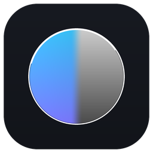
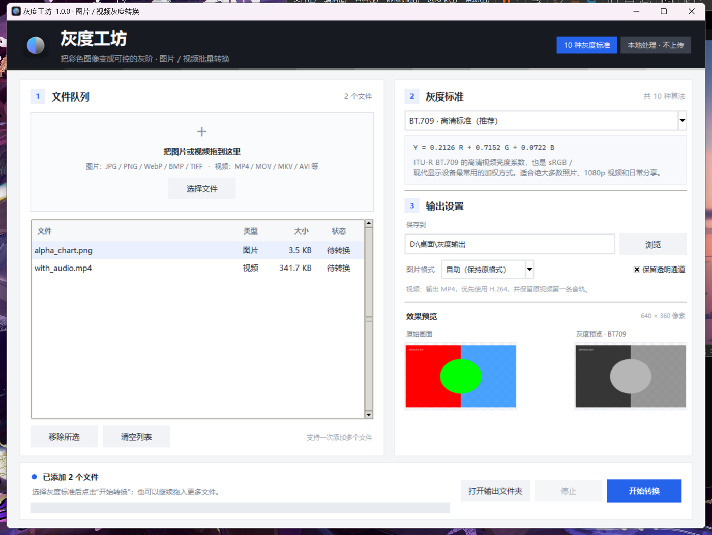

<div align="center">
  
  <h1>灰度工坊 · Grayscale Studio</h1>
  <p>把图片和视频转换成<strong>可控的灰度画面</strong>。拖入文件、选择灰度标准、开始转换。</p>
  <p>Windows 与 Ubuntu 桌面工具 · 全部本地处理 · 不联网</p>

  
  
  
</div>



## 简介

**灰度工坊**是一个专注于灰度转换的跨平台桌面应用。它不把“去色”简单等同于一个按钮，而是把常见的灰度算法做成可选标准：

- **10 种灰度标准**：BT.709、BT.601、BT.2020、sRGB 感知亮度、CIE Lab L*、算术平均、HSL、HSV、最小值、Photoshop 经典亮度。
- **图片 + 视频**：支持 JPG / PNG / WebP / BMP / TIFF 和 MP4 / MOV / MKV / AVI 等常见媒体格式。
- **实时预览**：选择文件后立即看到原图与灰度效果，切换标准即可对比。
- **批量转换**：一次添加多个文件，按队列处理并显示进度。
- **透明通道**：PNG / WebP / TIFF 可保留 Alpha。
- **保留视频音轨**：输出 H.264 MP4，并保留原视频第一条音轨。
- **本地处理**：所有转换都在你的电脑上完成，不上传文件。

> English: Grayscale Studio is a cross-platform desktop converter for images and videos. Pick one of ten grayscale standards, preview the result, and convert files in batches locally.

## 下载

| 平台 | 文件 | 大小 | 说明 |
| --- | --- | --- | --- |
| Windows 10/11 x64 | `GrayscaleStudio-1.0.0-Windows-x64.zip` | 约 68 MB | 解压后双击 `灰度工坊.exe`，无需 Python |
| Ubuntu 22.04+ x64 | `GrayscaleStudio-1.0.0-Linux-x64.tar.gz` | 约 99 MB | 解压后运行 `安装到桌面.sh`，或直接双击可执行文件 |

前往 **[Releases](https://github.com/IX99999999/Gray-Workshop/releases/latest)** 下载。也可查看 [PDF 使用说明书](docs/灰度工坊-使用说明书.pdf)。

安装包内置 Python、Tk、Pillow、NumPy 和 ffmpeg，不依赖系统 Python。Windows 可执行文件没有数字签名，首次运行时如遇 SmartScreen，选择“更多信息 → 仍要运行”。

## 灰度标准

| 标准 | 公式（作用于 sRGB 编码值） | 适用场景 |
| --- | --- | --- |
| BT.709 · 高清（默认） | 0.2126R + 0.7152G + 0.0722B | HD 视频、现代显示器、日常转换 |
| BT.601 · 标清 | 0.299R + 0.587G + 0.114B | SD 视频、传统 OpenCV / MATLAB 实现 |
| BT.2020 · 超高清 | 0.2627R + 0.6780G + 0.0593B | 4K / 8K、广色域素材 |
| sRGB 感知亮度 | sRGB → 线性光 → BT.709 加权 → sRGB | 需要物理亮度关系的合成与蒙版 |
| CIE Lab L* | 线性光 Y → L* = 116f(Y) − 16 | 感知均匀的明度分析 |
| 算术平均 | (R+G+B) / 3 | 教学、算法比较、特殊效果 |
| HSL 明度 | (max+min) / 2 | 去饱和式灰度 |
| HSV 明度 | max(R,G,B) | 高光、阈值与灯光分析 |
| 最小值法 | min(R,G,B) | 暗通道、遮罩、艺术效果 |
| Photoshop 经典亮度 | 0.3R + 0.59G + 0.11B | 接近旧版 Photoshop 的观感 |

> 对纯红、纯蓝等极端颜色，不同标准的结果可能差异巨大，这是各标准定义不同所致。

## 快速开始

1. 打开灰度工坊。
2. 把图片 / 视频拖入窗口，或点击“选择文件”。
3. 在右侧下拉列表中选择灰度标准，查看预览。
4. 设置输出文件夹；图片还可选择 PNG / JPEG / WebP / TIFF 和是否保留透明通道。
5. 点击“开始转换”，完成后点击“打开输出文件夹”。

输出文件会自动带上标准代码：

```text
照片_灰度_BT709.png
录像_灰度_BT709.mp4
```

同名文件不会覆盖，程序会自动追加 `-2`、`-3`。

### 快捷键

| 快捷键 | 功能 |
| --- | --- |
| `Ctrl + O` | 添加文件 |
| `Ctrl + Enter` | 开始转换 |
| `Delete` | 移除列表中选中的文件 |

## 视频与透明通道

- 视频逐帧套用所选灰度公式，再用 ffmpeg 编码为 H.264 MP4。
- 原分辨率和帧率会保留；画面尺寸为奇数时会补一行/一列边缘像素。
- 只保留原视频的第一条音轨；字幕、章节和多音轨不会保留。
- PNG / WebP / TIFF 可以保留 Alpha。JPEG / BMP 不支持透明通道，透明区域会铺为白色。
- 视频转换过程中可以随时停止；已完成的文件保留，未完成的临时文件会被清理。

## 从源码运行

需要 Python 3.9+ 和 Tkinter。

```bash
python -m venv .venv
# Windows
.venv\Scripts\python -m pip install -r requirements.txt
.venv\Scripts\python main.py
# Ubuntu
.venv/bin/python -m pip install -r requirements.txt
.venv/bin/python main.py
```

Ubuntu 如果缺少 Tkinter：`sudo apt install python3-venv python3-tk`。

## 构建安装包

### Windows

```bat
build_windows.bat
```

输出 `发布\Windows\灰度工坊.exe`。构建需要网络下载依赖，最终单文件会内置 ffmpeg。

### Ubuntu

```bash
chmod +x build_linux.sh install_linux.sh
./build_linux.sh
./install_linux.sh
```

输出单文件程序并安装到 `~/.local/share/grayscale-studio/`，同时创建桌面和应用菜单入口。生成的分享包位于 `~/桌面/GrayscaleStudio-1.0.0-Linux-x64.tar.gz`。

### 生成 PDF 使用说明书

```bash
python -m pip install -r requirements-dev.txt
python tools/build_manual.py
```

脚本使用 Microsoft Edge / Chrome 的 headless 模式导出 PDF。

## 项目结构

```text
Gray-Workshop/
├─ main.py                  启动入口
├─ app/
│  ├─ ui.py                 Tkinter 图形界面
│  ├─ engine.py             图片 / 视频转换引擎
│  └─ standards.py          10 种灰度标准
├─ assets/                  图标与品牌素材
├─ docs/                    截图、使用说明书、分享说明
├─ tools/                   图标生成与版本信息
├─ build_windows.bat
├─ build_linux.sh
├─ install_linux.sh
└─ requirements.txt
```

## 隐私

程序不包含网络请求代码，没有遥测、账户系统或云上传功能。图片和视频只在当前电脑上读取、转换和写入。

## 常见问题

**为什么不同标准的结果差别这么大？**  
各标准的权重、线性化方式和定义不同。默认 BT.709 适合绝大多数日常内容；科研或合成可尝试 sRGB 感知亮度或 CIE Lab L*。

**视频为什么变大了？**  
源视频可能使用高压缩率编码，输出会重新编码为 H.264。相同分辨率下文件大小取决于源内容和编码参数。

**拖拽不工作？**  
可随时点击“选择文件”。Linux 桌面环境需要支持 XDND；不支持时不影响其他功能。

**支持 HEIC、AVIF 吗？**  
当前版本不支持，建议先转换为 JPG 或 PNG。

## 许可证与第三方组件

本项目源码采用 [MIT License](LICENSE) 发布。发布包内含的 ffmpeg 可执行文件按 GPL 条款分发，其他第三方组件许可见 [THIRD_PARTY_NOTICES.md](THIRD_PARTY_NOTICES.md)。

---

如果这个项目对你有帮助，欢迎点一个 **Star**，也欢迎提交 Issue 反馈问题。
