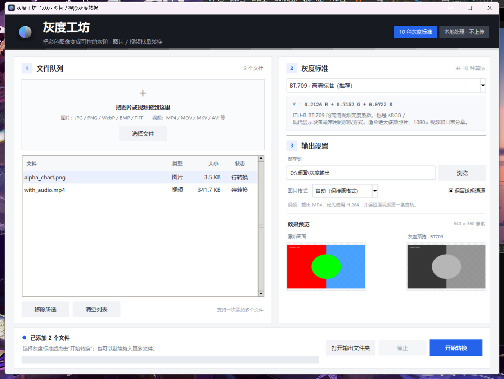

# 灰度工坊 · 使用说明书

**版本：** 1.0.0  
**更新日期：** 2026 年 11 月 6 日  
**支持平台：** Windows 10/11 x64、Ubuntu 22.04 及以上 x64  
**项目主页：** <https://github.com/IX99999999/Gray-Workshop>

[TOC]

<div class="page-break"></div>

## 1. 产品概览

灰度工坊是一款把彩色图片或视频转换为灰度内容的桌面工具。它的重点不是简单地“去掉颜色”，而是让你在转换前选择一种明确的灰度标准，并实时比较不同算法带来的明暗差异。

程序提供 Windows 与 Ubuntu 两个平台的图形界面版本。图片、视频的解码、转换和编码全部在本机完成，软件没有账户、上传、云端同步或遥测功能。



### 主要能力

- 支持图片与视频的批量转换；
- 转换前从 10 种灰度标准中选择；
- 原图 / 灰度并排预览；
- 图片可选 PNG、JPEG、WebP、TIFF 输出；
- 视频输出 H.264 MP4，尽量保留第一条音轨；
- 保留 PNG / WebP / TIFF 的透明通道；
- 任务可停止，已完成文件不会丢失；
- 记住上次使用的标准、格式与输出文件夹。

## 2. 安装与启动

### 2.1 Windows 10 / 11

1. 下载 `GrayscaleStudio-1.0.0-Windows-x64.zip`。
2. 解压到任意可写目录，例如 `D:\Apps\灰度工坊`。
3. 双击 `灰度工坊.exe`。

程序是单文件便携版，已经内置 Python、Tk、Pillow、NumPy 和 ffmpeg，不需要安装 Python 或 ffmpeg。

> **Windows SmartScreen 提示：** 当前版本没有购买代码签名证书。如果 Windows 提示“已保护你的电脑”，点击“更多信息 → 仍要运行”。请只运行来自可信来源的安装包。

如果希望创建桌面入口，可以右键 `灰度工坊.exe` → “发送到” → “桌面快捷方式”。

### 2.2 Ubuntu 22.04 及以上

**第 1 步：下载。** 获取 `GrayscaleStudio-1.0.0-Linux-x64.tar.gz`。

**第 2 步：解压。** 解压后得到“灰度工坊”文件夹。

**第 3 步：运行安装脚本。** 在终端进入该文件夹并执行：

```bash
cd 灰度工坊
chmod +x 安装到桌面.sh
./安装到桌面.sh
```

**第 4 步：启动。** 安装后可以从桌面或应用菜单启动“灰度工坊”。

安装脚本不需要 sudo，会把程序放入 `~/.local/share/grayscale-studio/`，并在桌面和应用菜单中创建入口。若不想安装，也可以直接双击文件夹里的 `灰度工坊` 可执行文件。

> 如果文件管理器不允许双击运行，可在终端执行 `./灰度工坊`。如果提示没有执行权限，执行 `chmod +x 灰度工坊`。

### 2.3 从源码运行

源码运行需要 Python 3.9 或更高版本，以及 Tkinter。

Windows：

```bat
py -m venv .venv
.venv\Scripts\python -m pip install -r requirements.txt
.venv\Scripts\python main.py
```

Ubuntu：

```bash
sudo apt install python3-venv python3-tk
python3 -m venv .venv
.venv/bin/pip install -r requirements.txt
.venv/bin/python main.py
```

源码运行需要安装依赖；发布包已经包含全部运行依赖。

## 3. 界面说明

程序窗口分为三个区域：

1. **文件队列**（左侧）：拖拽或选择文件、查看文件类型 / 大小 / 状态、移除或清空文件。
2. **灰度标准**（右侧上方）：下拉选择 10 种算法之一，下方的公式和说明会同步更新。
3. **输出设置与效果预览**（右侧中下部）：设置保存位置、图片格式、透明通道选项，并查看原图和灰度效果。

底部状态栏显示当前任务进度、成功数量与输出位置。转换过程中，右上角的标准选择和输出设置会暂时锁定，避免中途改变任务参数。

### 界面上的状态

| 状态 | 含义 |
| --- | --- |
| 待转换 | 文件已加入队列，尚未开始 |
| 转换中 | 正在读取或编码该文件 |
| 已完成 | 成功生成输出文件 |
| 失败 | 文件格式损坏、权限不足或编码器错误 |
| 已取消 | 点击“停止”后未处理或中断的文件 |

## 4. 快速上手

1. 启动程序。
2. 把一张图片或一段视频拖进左侧区域，或点击“选择文件”。
3. 选中文件，在右侧“灰度标准”下拉列表中选择算法。
4. 确认预览：左侧为原始画面，右侧为灰度画面。
5. 在“输出设置”中选择保存位置。默认位置为当前用户桌面的“灰度输出”文件夹。
6. 对图片，可选择“自动（保持原格式）”、PNG、JPEG、WebP 或 TIFF；视频统一输出 MP4。
7. 点击“开始转换”，观察底部进度。
8. 完成后点击“打开输出文件夹”。

一次可以添加多个文件，程序会按队列顺序处理。添加文件后，状态栏会显示队列数量；使用“移除所选”或“清空列表”调整队列。

### 快捷键

| 快捷键 | 功能 |
| --- | --- |
| `Ctrl + O` | 选择要添加的文件 |
| `Ctrl + Enter` | 开始转换 |
| `Delete` | 移除文件列表中选中的项目 |

## 5. 灰度标准详解

### 5.1 选择哪一个？

对大多数照片、网页图片和 1080p 视频，默认的 **BT.709** 是最稳妥的选择。它也是 sRGB 环境中最常用的亮度权重。

如果素材来自标清电视或需要与 OpenCV / MATLAB 的结果对照，选择 **BT.601**；如果需要处理 4K/8K 广色域内容，选择 **BT.2020**。需要做亮度合成、蒙版或科学分析时，可以尝试 **sRGB 感知亮度** 或 **CIE Lab L***。

### 5.2 十种标准

| 标准 | 公式 | 特点与适用场景 |
| --- | --- | --- |
| BT.709 · 高清 | Y = 0.2126R + 0.7152G + 0.0722B | 高清视频与现代显示设备的常用权重，默认推荐 |
| BT.601 · 标清 | Y = 0.299R + 0.587G + 0.114B | 标清电视与经典图像处理实现，红色通常比 BT.709 更亮 |
| BT.2020 · 超高清 | Y = 0.2627R + 0.6780G + 0.0593B | 4K/8K 广色域视频，绿色权重更高 |
| sRGB 感知亮度 | sRGB → 线性光 → BT.709 加权 → 编码回 sRGB | 更符合物理亮度关系，适合合成与蒙版 |
| CIE Lab L* | 线性光 Y → L* = 116f(Y) − 16 | 按人眼感知均匀表示明度，通常更亮、层次更均匀 |
| 算术平均 | (R + G + B) / 3 | 三通道等权，计算简单，画面容易发灰 |
| HSL 明度 | (max + min) / 2 | 常见的去饱和式灰度，结果通常较亮 |
| HSV 明度 | max(R,G,B) | 高饱和色会被提亮，适合高光/阈值分析 |
| 最小值法 | min(R,G,B) | 暗通道分析、遮罩与艺术效果 |
| Photoshop 经典亮度 | 0.3R + 0.59G + 0.11B | 接近早期 Photoshop 的近似系数 |

BT.601、BT.709、BT.2020 的系数直接作用在 **编码后的** R′G′B′ 上；sRGB 感知亮度和 CIE Lab L* 会先把 sRGB 还原为线性光再计算。因此，纯红、纯绿、纯蓝等极端颜色在不同标准下的数值差异可能非常明显。

## 6. 输出设置与文件命名

### 6.1 保存位置

默认输出文件夹：

- Windows：当前用户桌面下的 `灰度输出`
- Ubuntu：`~/桌面/灰度输出`

可以点击“浏览”更改。目标文件夹不存在时，程序会自动创建。

### 6.2 图片输出格式

| 选项 | 特点 |
| --- | --- |
| 自动（保持原格式） | JPG→JPEG，PNG→PNG，WebP→WebP，BMP→BMP，TIFF→TIFF |
| PNG | 无损、支持 Alpha，适合存档和界面素材 |
| JPEG | 质量 95，不支持透明，透明区域铺白 |
| WebP | 无损、支持 Alpha，体积通常更小 |
| TIFF | 无损、支持 Alpha，适合印刷 / 图像处理流程 |

### 6.3 文件命名

输出文件名为：

```text
原文件名_灰度_标准代码.扩展名
```

例如：

```text
风景_灰度_BT709.png
录像_灰度_BT709.mp4
```

不会覆盖原文件。如果目标文件已经存在，会自动使用 `-2`、`-3` 等后缀。不同标准的输出会保留各自的标准代码，便于对照。

## 7. 视频处理细节

- 视频逐帧转换，输出分辨率与源视频一致，帧率保持源帧率。
- 输出容器为 MP4，优先使用 H.264 (`libx264`) 编码，像素格式为 `yuv420p`，兼容大多数播放器。
- 保留源视频第一条音轨，并重新编码为 AAC 192 kbps。
- 不保留字幕、章节、多音轨或附加数据。
- 如果源视频分辨率为奇数，编码前会补一行/一列边缘像素，以满足 H.264 的偶数尺寸要求。
- 视频处理速度取决于分辨率、时长和 CPU。可以随时点击“停止”，当前视频的未完成临时文件会被删除，其他已完成的视频保留。
- 视频文件大小通常会变化，因为输出使用新的编码器和码率控制参数。

> 建议不要直接转换受 DRM 保护的视频；程序只负责解码能由 ffmpeg 正常读取的文件。

## 8. 透明通道

PNG、WebP 和 TIFF 可以保存 Alpha 通道。转换后的灰度图会使用 `L + Alpha`（或 WebP 的等价表示）保存，透明区域保持透明。

JPEG 和 BMP 不支持透明通道：
- 如果图片带透明区域，转换时会先把透明区域铺为白色，再计算灰度；
- 这样可以避免透明区域变成不可预期的黑色或杂色。

如果不需要透明通道，可以取消“保留透明通道”选项。

## 9. 批量转换与停止

- 一次可添加任意数量的图片和视频（受磁盘与内存影响）。
- 队列按添加顺序处理；同一时间只运行一个转换任务。
- 状态栏显示总进度和当前文件。
- 点击“停止”后：
  - 当前正在读取的视频会在当前帧后结束；
  - 当前未完成的输出文件会被删除；
  - 尚未开始的文件标记为“已取消”；
  - 已经完成的文件保留。
- 停止后再次点击“开始转换”，队列会从第一个文件重新开始（同名文件会自动添加序号）。

## 10. 分享程序

### Windows

把 `灰度工坊.exe` 发给 Windows 10/11 x64 用户即可。对方无需安装 Python、ffmpeg 或其他依赖。完整压缩包还包含本说明书和第三方许可说明。

### Ubuntu

把 `GrayscaleStudio-1.0.0-Linux-x64.tar.gz` 发给对方。解压后：

```bash
cd 灰度工坊
chmod +x 安装到桌面.sh
./安装到桌面.sh
```

也可以直接运行文件夹里的 `灰度工坊` 可执行文件。

### 注意

- 便携版体积较大，是因为内置了 Python 运行时、图形库和 ffmpeg。
- 请从可信来源获取程序，运行前可核对发布页提供的 SHA256 校验值。
- 便携版不包含自动更新功能。

## 11. 数据与隐私

灰度工坊不包含任何网络请求、账户系统、广告、统计或上传逻辑。

程序会读取以下本地内容：

- 你主动添加的图片 / 视频；
- 当前用户目录下的配置文件 `.grayscale_studio.json`（用于记住标准、输出目录、图片格式等设置）；
- 运行时的临时文件（打包版由 PyInstaller 和 ffmpeg 使用，退出后清理）。

## 12. 常见问题

**转换按钮没有反应？**  
先确认队列里至少有一个文件，且输出文件夹可写。如果输出目录被占用或没有权限，程序会提示错误。

**视频转换失败？**  
检查源文件是否能被普通播放器打开；确认磁盘空间充足。打包版已内置 ffmpeg，如果使用的是源码版，请先安装 `imageio-ffmpeg`。

**为什么彩色图片转换后，不同算法差异很大？**  
灰度标准定义不同。纯色和强饱和区域最容易暴露差异；日常照片通常更接近。

**为什么输出视频比源视频大？**  
输出重新编码为 H.264，码率控制与源编码不同；这不代表画质必然更好或更差。

**可以处理 4K/8K 视频吗？**  
可以，但需要更多内存与 CPU。建议先测试短片段，确认输出效果和速度。

**如何卸载？**  
Windows 直接删除程序文件夹或 exe；可选删除 `%USERPROFILE%\.grayscale_studio.json`。Ubuntu 删除 `~/.local/share/grayscale-studio/`、桌面 / 应用菜单快捷方式和配置文件即可。

## 13. 构建与项目结构

项目结构：

```text
Gray-Workshop/
├─ main.py                  启动入口
├─ app/
│  ├─ ui.py                 Tkinter 界面
│  ├─ engine.py             图片 / 视频转换引擎
│  └─ standards.py          10 种灰度标准
├─ assets/                  图标
├─ docs/                    截图、说明书
├─ tools/                   图标与版本信息
├─ build_windows.bat
├─ build_linux.sh
└─ install_linux.sh
```

Windows 构建：

```bat
build_windows.bat
```

Ubuntu 构建：

```bash
./build_linux.sh
./install_linux.sh
```

打包使用 PyInstaller 单文件模式，ffmpeg 由 `imageio-ffmpeg` 提供并打入程序中。

## 14. 许可证与第三方组件

灰度工坊源码使用 MIT License。发布包内含的 ffmpeg 构建包含 libx264，按 GPL 条款分发；Pillow、NumPy、tkinterdnd2、Python、Tcl/Tk 等组件保留各自许可。完整说明见仓库中的 `THIRD_PARTY_NOTICES.md`。

## 附录：文件类型支持

| 类别 | 扩展名 |
| --- | --- |
| 图片 | `.jpg` `.jpeg` `.png` `.webp` `.bmp` `.tif` `.tiff` |
| 视频 | `.mp4` `.mov` `.mkv` `.avi` `.m4v` `.wmv` `.flv` `.webm` `.ts` `.mts` `.m2ts` `.3gp` `.mpg` `.mpeg` `.ogv` |

不支持的图片格式（如 HEIC、AVIF）会提示跳过；可以先转换为 JPG / PNG。

---

**感谢使用灰度工坊。**  
问题反馈与更新请访问：<https://github.com/IX99999999/Gray-Workshop>
